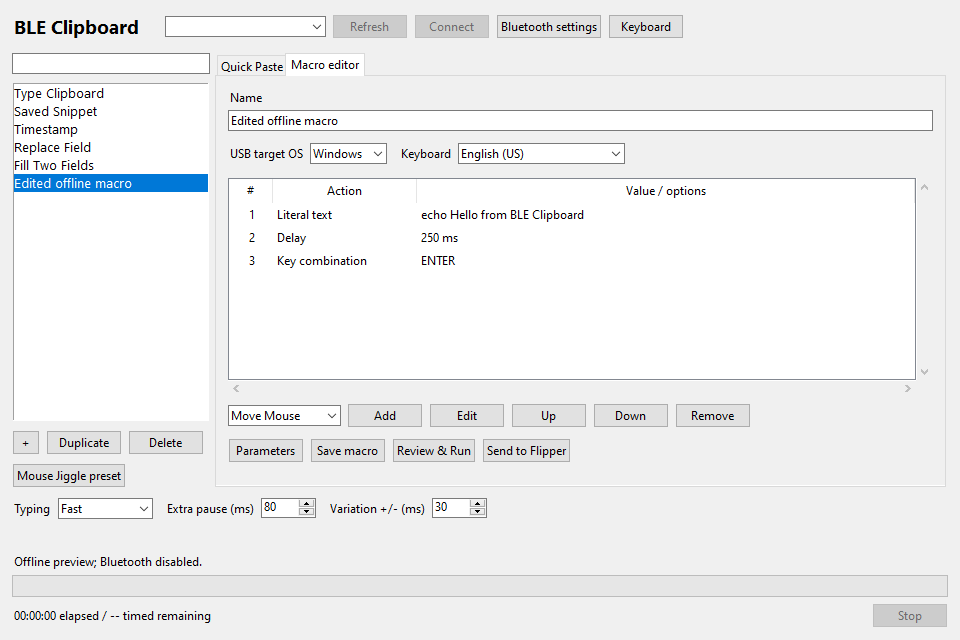
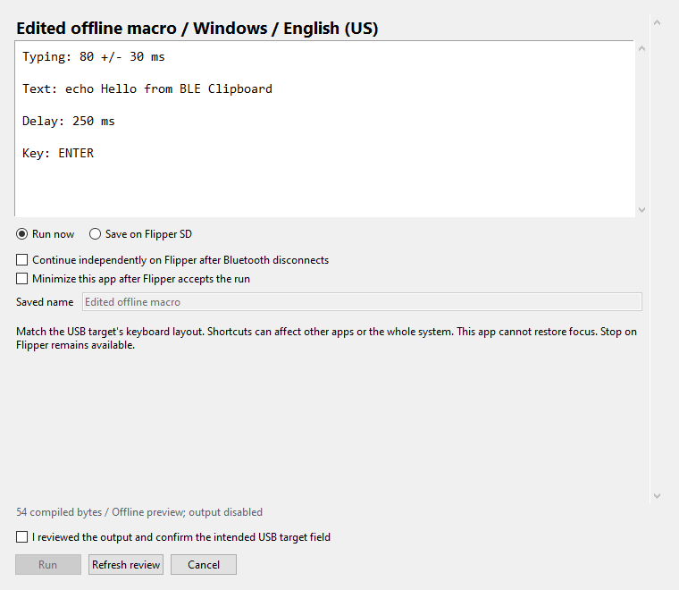

<p align="center"></p>

<h1 align="center">BLE Clipboard</h1>
<p align="center">Your clipboard and macros. Flipper Zero. Any USB target.</p>

Paste long snippets, fill fields, or run a repeat without installing software on
the receiving computer. Create and review the job on your Mac or Windows PC;
Flipper delivers it as a USB keyboard and mouse.

```text
Mac / Windows sender -- Bluetooth LE --> Flipper Zero -- USB --> Target computer
```

The sender and USB target can be the same computer or different computers.
macOS, Windows and Linux are **USB targets**; Linux is not a supported sender.
Free and open source, GPL-3.0-only.

## See It Working


**Real Mac-to-Flipper-to-USB run, version 0.5.3.** Captured during the final delay,
after all 99 text bytes arrived. The [received output](docs/assets/usb-macro-output.jpg)
matched byte for byte. This limited demonstration is not a 0.5.4 hardware test.

<p>
  
  
</p>

More [screenshots](#screenshots) and [capture provenance](docs/ARTWORK.md).

## Downloads

**Get the matching 0.5.4 apps.** Choose one desktop sender and install the Flipper
companion separately. Windows is an unsigned x64 beta.

| App | Download | Requirements |
| --- | --- | --- |
| Mac sender | [Universal ZIP](https://github.com/otcan/ble-clipboard/releases/download/v0.5.4/BLE-Clipboard-0.5.4-universal.zip) | macOS 14+, Apple Silicon or Intel; signed and notarized release |
| Windows sender | [Installer](https://github.com/otcan/ble-clipboard/releases/download/v0.5.4/BLE-Clipboard-0.5.4-windows-x64-setup.exe) · [Portable ZIP](https://github.com/otcan/ble-clipboard/releases/download/v0.5.4/BLE-Clipboard-0.5.4-windows-x64-portable.zip) | Windows 10 2004+ / 11, x64; unsigned beta, bundled Python |
| Flipper companion | [ble_clipboard.fap](https://github.com/otcan/ble-clipboard/releases/download/v0.5.4/ble_clipboard.fap) | Official firmware 1.5.1 / API 88.2, microSD card |

[Release page](https://github.com/otcan/ble-clipboard/releases/tag/v0.5.4) ·
[Checksums](https://github.com/otcan/ble-clipboard/releases/download/v0.5.4/SHA256SUMS.txt) ·
[Changelog](CHANGELOG.md)

## Install the Matching Pair

You need **one desktop sender plus the Flipper app from the same release**.
The USB target needs neither app, developer tools nor custom firmware.

### 1. Desktop Sender

**Mac, with Homebrew:**

```sh
brew tap otcan/ble-clipboard
brew install --cask otcan/ble-clipboard/ble-clipboard
```

Without Homebrew, unzip the Mac download and move **BLE Clipboard.app** to
Applications. Quit your older copy before replacing it.

**Homebrew installs only the Mac sender, not the Flipper app or Windows app.**

**Windows beta:** use the per-user installer or extract the
whole portable ZIP. Python is bundled. No administrator rights are required;
installation does not change Bluetooth settings or start output. This beta is
unsigned, so Windows may show a reputation/signing warning. Verify its release
and checksum; managed computers may block it. No automatic installation occurs.

### 2. Flipper Companion

New to Flipper software? Install [qFlipper](https://flipper.net/pages/downloads),
the official desktop file manager, on Mac or Windows. On Mac you can also use:

```sh
brew install --cask qflipper
```

1. Download **ble_clipboard.fap** from the matching release. Keep that filename;
   it is an app file, not an archive.
2. Stop any job, exit the Flipper app to its home screen, and connect USB to
   your sender computer with a **data cable**. Leave the microSD card inserted.
3. In qFlipper, open **File Manager > SD Card > apps > Bluetooth**. Create the
   folders if missing, then upload the FAP. Preserve an older copy before replacing it.
4. On Flipper, open **Apps > Bluetooth > BLE Clipboard**.

The device path is `/ext/apps/Bluetooth/ble_clipboard.fap`. qFlipper is only
needed to copy the file; close it before normal use. See the
[official file-upload guide](https://docs.flipper.net/zero/qflipper#how-to-upload-files-using-qflipper).

Alternatively, power Flipper off, copy the FAP to `apps/Bluetooth/` using a
microSD card reader, safely eject the card, reinsert it and power Flipper on.

The [Flipper catalog submission](https://github.com/flipperdevices/flipper-application-catalog/pull/1379)
is separate from the downloadable FAP. Maintainer review/acceptance is not implied.

### 3. Connect and Run

1. Open both apps. On Windows, pair **Paste** in Bluetooth settings first and
   approve matching codes on both devices. Refresh the sender's list and choose
   your Flipper. On Mac, use Connect and allow Bluetooth access.
2. Connect Flipper's USB cable to the target computer you are authorized to operate.
3. Choose Quick Paste or a macro. Match the **target's OS and active keyboard layout**.
4. Review the expanded text/actions. Focus the intended target field, then
   explicitly confirm **Run**. Start in a disposable plain text document.

**Stop:** use Stop in the desktop companion or **Left/Back** on Flipper. Stop
releases Flipper-held keys/buttons; it cannot undo input. Newlines send Enter.
Global shortcut handlers can intercept keys, especially Option-based mappings;
hiding the sender does not guarantee focus restoration.

### Updating

Quit the Mac app yourself before upgrading:

```sh
brew update
brew upgrade --cask otcan/ble-clipboard/ble-clipboard
```

On Windows, close the sender before using the matching installer or replacing
the portable folder. Libraries stay in `%APPDATA%\BLE Clipboard`; reinstall and
uninstall preserve them. Separately exit the Flipper app and replace its FAP.
No firmware flash, SD formatting or pairing-key deletion is needed.

## Clipboard, Macros and Standalone Jobs

| Workflow | What it does |
| --- | --- |
| Quick Paste | Explicitly load clipboard text or a text file, review it, then type it over USB. |
| Macro library | Search, create, duplicate, edit and reorder text, templates, parameters, shortcuts, delays, Move Mouse and Repeat. Import/export JSON compatible with Mac and Windows. |
| Typing speed (0.5.4) | Fast retains normal timing; Slow adds 80 ms per character; Variable adds 80 +/- 30 ms; Custom stays within 0-1000 ms. |
| Send to Flipper | Save a compiled plaintext snapshot without running it. Clipboard, parameters, timestamp and pacing are captured in the review. Up to 20 entries. |
| Standalone runs | Explicitly continue without the desktop sender. Flipper shows elapsed/remaining time, retains physical Stop and ends on USB loss, app exit or power loss. Reconnect to inspect/stop without replay. |

On Flipper, **Up/Down** selects a saved entry, **OK** opens it, and **Run** needs
a second confirmation. **Right** opens Delete confirmation. Entries survive
restart but never run automatically. Resending the same macro replaces its snapshot.

Move Mouse and Repeat accept fixed values or ranges. The Mouse Jiggle preset
uses eight hours, X/Y -2...2 HID units and 45...95-second intervals. Movement
releases Flipper-held buttons first, but cannot override another mouse's held
button or OS drag lock. It may drift; no undetectability or idle-policy claim.

## Keyboard Settings

**Left > Keyboard** on idle Flipper: choose
any of 28 layouts and the target OS, then **Save keyboard**. It persists on SD.
**Saved runs: Device** uses it for local runs without rewriting snapshots;
**Original** retains the saved keyboard and remains the upgrade default.

Flipper wins on desktop reconnect, including changes made without a companion.
Quick Paste/new macro defaults follow it; existing desktop macros retain their
explicit target/layout. Saved shortcuts remain compiled for their original OS;
resend the macro to change shortcut semantics. Settings are locked during a job.

US and macOS Turkish Q are built in. Most other layouts need the official `.kl`
file under `/ext/badusb/assets/layouts/`. Missing/unmapped assets reject the job
before input rather than falling back to English. macOS Turkish Q targets
**Turkish QWERTY PC**, not Legacy.

Printable ASCII, Tab and line breaks are supported. Native Turkish letters are
experimental with Turkish Q. Arbitrary Unicode, other native alphabets and IME
input are not supported. See [all layouts and macro limits](docs/MACROS.md).

## Screenshots

The Mac live run and genuine Flipper captures above are **0.5.3**, not new 0.5.4
hardware evidence. [Completed run](docs/assets/mac-live-complete.jpg) ·
[Quick Paste preview](docs/assets/mac-quick-paste.jpg) ·
[Macro workspace preview](docs/assets/mac-macros.jpg).

Windows CI renders use synthetic libraries, with Bluetooth and output disabled.
They validate editing/review/error layouts, not physical transfers. See
[screenshot provenance](docs/ARTWORK.md) and [Windows parity](docs/WINDOWS-PARITY.md).





## Privacy and Limits

Clipboard access is explicit: no watcher, global hook, cloud account, analytics
or automatic replay. Pairing protects transfers; saved desktop definitions,
backups, exports and Flipper snapshots are **plaintext**. Transfers larger than
4 KiB use a temporary SD file. Deletion is not secure erasure.

0.5.4 physical BLE/USB, target focus/layout and multi-hour checks remain
**unverified**. Prior limited hardware results do not certify this version.
Windows is beta; native ARM64, Linux senders and App Store distribution are
outside this release. [Validation record](docs/HARDWARE-VALIDATION.md).

Info & Companions shows actual app versions and checks the **exact version's**
GitHub assets before enabling downloads; there is no latest/older-version fallback.
On idle Flipper, **Right > OK** opens its version-pinned release QR.

## Development and Feedback

```sh
swift test --package-path BLEClipboardMac
PYTHON=/path/to/python3.12 sh scripts/check_clipboard.sh
UFBT=ufbt sh scripts/build_flipper.sh
BLEClipboardMac/build_app.sh --universal
```

Install `BLEClipboardWindows/requirements.txt` in that Python environment first.
Windows distributions must be built on native Windows x64; see its
[build guide](BLEClipboardWindows/README.md). Builds do not install apps or start input.

[Open an issue](https://github.com/otcan/ble-clipboard/issues) with sender OS,
Flipper firmware, target layout and non-sensitive reproduction steps.

[Macro guide](docs/MACROS.md) · [Protocol](docs/PROTOCOL.md) ·
[Release development](docs/DEVELOPMENT.md) · [Changelog](CHANGELOG.md) ·
[Security](SECURITY.md) · [License](LICENSE) · [Notices](NOTICE)

Not affiliated with Flipper Devices, Apple, Microsoft or Homebrew.
