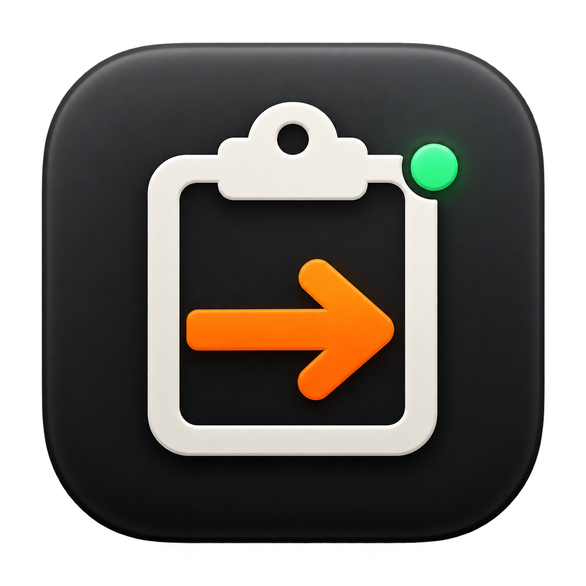

<p align="center">
  
</p>

<h1 align="center">BLE Clipboard 0.5.2</h1>

An independent Mac and Flipper Zero clipboard and macro pair. No Ducker runtime,
source, protocol, submodule or build dependency is used in this version.

```text
Mac app -- authenticated Bluetooth LE --> Flipper app -- USB keyboard --> Target
```

**Development build, not published or notarized.** Update both apps together.
Existing Homebrew/public 0.1.x downloads are not this version. The new engine's
local tests pass, but live focus/shortcut and wider hardware validation remain
open. No build command installs an app, starts typing or submits to Apple.

## Features

- Quick Paste, explicit clipboard loading and UTF-8 text-file import.
- Local saved macros with literal text, templates, parameters, key combinations
  and delays; create/edit/reorder/duplicate/delete and JSON import/export.
- Generic Move Mouse with fixed/ranged X/Y offsets, and timed Repeat blocks
  with fixed/ranged intervals. Mouse Jiggle is a preset, not an action.
  Up to 24 hours total, Flipper timer and physical Stop remain available.
- Send clipboard snapshots or compiled macros to a 20-entry Flipper SD library;
  browse, confirm Run, or delete on the Flipper without a Mac connection.
- Expanded-output review and explicit target-focus confirmation before Run.
- 28 target layout choices shared by Quick Paste and macros.
- Experimental native Turkish letters with Turkish Q; decomposed input is
  normalized. Arbitrary Unicode and other native scripts/IME input remain unsupported.
- Independent typed binary format: `[ENTER]` in text remains text, not a command.
- Up to 65,536 encoded program bytes; bounded acknowledged chunks, CRC-32 and
  full program/layout validation before an execution request can type anything.
- Normal jobs stop on link loss; explicitly standalone jobs continue until
  completion, physical Stop or USB loss. Reconnect can attach remote Stop.
  No automatic run after reconnect, restart or USB reconnection.
- Universal Apple Silicon/Intel Mac build; official Flipper firmware 1.5.1/API 88.2.
- Info & Companions with version-pinned downloads and device-reported versions;
  a Flipper About screen includes the matching release QR code.

## Build

Requires macOS 14+, Xcode/Swift and uFBT configured for the matching official SDK.
No Git submodule setup is needed.

```sh
swift test --package-path BLEClipboardMac
sh scripts/check_clipboard.sh
UFBT=ufbt sh scripts/build_flipper.sh
scripts/package_release.sh 0.5.2
```

The package directory is `dist/v0.5.2/`, including the universal ZIP,
`ble_clipboard.fap`, corresponding source, notices and `SHA256SUMS.txt`.
The unpacked development Mac app is `BLEClipboardMac/dist/BLE Clipboard.app`.
The default signature is ad-hoc; Developer ID signing/notarization and publication
are separate deliberate actions. Never disable Gatekeeper.

## Install the Matching Pair

1. Use the Mac app built from this 0.5.2 source or its universal ZIP.
2. Exit the running Flipper app with Back so USB returns to serial mode.
3. Using qFlipper, place the matching `ble_clipboard.fap` under
   `/ext/apps/Bluetooth/` after preserving any older app you want to retain.
4. Open **Apps > Bluetooth > BLE Clipboard** on the Flipper.

Use the matching 0.5.2 pair. Existing 0.5.x protocol peers and saved jobs remain
compatible; older companions show Unknown app version in Info. The mouse-button
safety fix requires at least the 0.5.1 Flipper binary. Older
companion apps use different services and cannot run this protocol. No device
firmware change or pairing-key deletion is required. This repository's scripts
do not perform installation.

## Use

1. Open BLE Clipboard on the Mac. Connect, then choose the Flipper.
2. Allow Bluetooth and compare/approve matching pairing codes on both devices.
3. Connect Flipper USB to a target device you own or have permission to operate.
4. Choose Quick Paste or a saved macro. Match the target OS and keyboard layout.
5. Review the expanded text/keys, focus a disposable plain text document on the
   target, confirm the target, then Run on USB. Hide the Mac app if the same Mac
   is also the USB target; focus restoration must be checked, not assumed.

Stop on the Mac or Left on the Flipper cancels the current job and releases keys.
Back or Left stops a busy job. Back from the idle library exits and restores its
prior USB/Bluetooth configuration.
Cancellation cannot undo existing input or a partly entered dead-key sequence.
Tabs and newlines are real keys; do not begin with terminals, password fields or
forms that submit on Enter. Completion means HID submission, not target-app receipt.

## Standalone Jobs and Mouse Jiggle

The mouse icon creates the Mouse Jiggle preset: an eight-hour Repeat containing
Move Mouse, X/Y ranges -2...2 HID units, and intervals 45...95 seconds. Values
are sampled on Flipper during execution with the SDK random API. Equal endpoints
give a fixed value. Moves exclude zero/zero. HID units are not necessarily display
pixels; repeated relative movement may drift. Movement is not guaranteed invisible,
undetectable, or to prevent a particular OS/application's idle policy. USB identity and input events
remain observable. The jiggle operation does not request clicks, keys, sounds,
vibration or notifications.

Move Mouse releases all Flipper mouse buttons before each movement; a failed
button-up report stops the job without moving. Startup, Stop and exit clear
keyboard and mouse state too. This cannot release a physical mouse button held
on another device or disable an OS drag-lock setting.

Repeat supports text, keys, delays and Move Mouse. Nested repeats are rejected.
Its interval is measured between cycle starts; cycles never overlap. Each sequence
permits 128 steps, at most 512 total including bodies, within 64 KiB encoded.
The timed deadline takes precedence over pending input and releases held keys.

Existing 0.4 mouse definitions migrate to explicit fixed Move Mouse/Delay/Repeat
steps, preserving IDs, duration and layout. Existing Flipper binary snapshots
remain unchanged and playable; resend an edited macro to replace its snapshot.

In run review, Mouse Jiggle defaults **Continue on Flipper if this Mac
disconnects** on. This is an explicit per-run choice, not a change to normal jobs.
Flipper shows elapsed/remaining time; Left or Back stops it even offline.
Reconnect the Mac to view and stop the active job, without restarting it.
USB loss, exiting the Flipper app or power loss stops output permanently.

**Send to Flipper** saves without executing. Confirm plaintext storage and name
the entry. Clipboard, timestamp and parameter values are fixed at send time.
Up to 20 entries persist under `apps_data/ble_clipboard/saved`. Sending the same
macro UUID replaces its snapshot; Quick Paste reviews create separate snapshots.
On Flipper, Up/Down selects, OK opens, and Run needs a second confirmation with
a three-second focus allowance. Right opens Delete confirmation. Saved files
survive restart, but jobs never start automatically.

## Layouts and Text

US/UK, Turkish Q, Bosnian, Czech, Danish, German/Swiss German, Dvorak,
Spanish/Latin American, French/Belgian/Canadian/Swiss/Mac French, Croatian,
Hungarian, Italian/Mac Italian, Japanese, Norwegian, Dutch, Portuguese/Brazilian,
Slovenian, Slovak and Swedish. Most non-US choices require their official `.kl`
asset under `/ext/badusb/assets/layouts/`. Missing or unmapped assets reject the
job before execution.

US and macOS Turkish Q are built in. The latter targets Apple's Turkish QWERTY PC
input source, not Turkish Q Legacy. Native Turkish letters are `U+00C7/00E7`,
`U+011E/011F`, `U+0130/0131`, `U+00D6/00F6`, `U+015E/015F`, `U+00DC/00FC`.
Other layouts support printable ASCII, Tab and line breaks, not arbitrary native
alphabets. A layout choice is not automatic target-language detection.

## Privacy

There is no cloud account, analytics service, clipboard watcher, global keyboard
hook, shell helper or target-side agent. Clipboard reads are explicit. Saved
macro definitions and one recovery backup are local; literal secrets saved in
macros or exported JSON remain plaintext and can enter system backups.

Small active jobs remain in Flipper RAM; jobs over 4 KiB use a temporary SD file,
removed on completion, Stop, exit and next startup. Normal link loss clears the
job; a standalone run retains it until stopped or complete. Explicit snapshots
persist on SD until deleted, with staging/recovery files during replacement.
SD files are plaintext; deletion is not secure erasure. There is no automatic
replay history. Logs omit text and parameter contents.
Bluetooth pairing protects transport; the protocol handshake is compatibility
negotiation, not a separate credential. CRC is integrity checking, not encryption.

## Documentation

[Macros](docs/MACROS.md) · [Protocol](docs/PROTOCOL.md) ·
[Build and release](docs/DEVELOPMENT.md) · [Validation](docs/HARDWARE-VALIDATION.md) ·
[Store preparation](Store/README.md) · [Changelog](CHANGELOG.md)

## Info and Companion Downloads

The Mac toolbar's Info button and Help > Info & Companions show the running Mac
version and the connected Flipper's reported app/build API version. Legacy peers
show Unknown rather than an inferred version. Different app versions are flagged
without claiming they cannot use the same compatible protocol.

Opening Info or refreshing it checks only the matching version's public GitHub
release. Both download links require the exact tag, published assets for the
universal Mac ZIP and Flipper FAP, and SHA256SUMS.txt. Missing releases show Not
published yet; offline/rate-limit failures do not claim a release is missing.
There is no fallback to an older public release or automatic download/install.
The Setup Guide, source and release notes are pinned to that version too.

On Flipper, Right from the idle saved list opens Info; OK opens Downloads with a
QR code for that app's exact release page. The QR target is not available until
the release is published. Info never launches a saved job, and busy jobs retain
the same physical Stop controls. The QR bitmap has a four-module quiet zone and
is generated by Core Image; camera/display scanning still needs hardware checks.

The historical 0.1.0 release was clipboard-only, ad-hoc signed and unnotarized,
with a 3,071-byte ASCII limit and US/Turkish-Q layouts. Those assets are unchanged;
they are not the 0.5.2 macro app. See the changelog for the preserved history.

## License

[GPL-3.0-only](LICENSE). Uses the public Flipper SDK and Apple's public frameworks.
Not affiliated with Flipper Devices, Apple or Homebrew. See [NOTICE](NOTICE).
