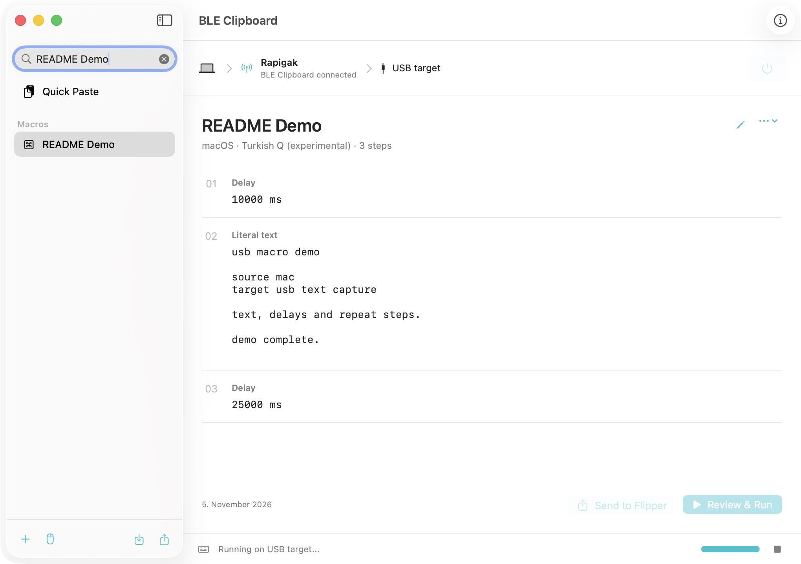
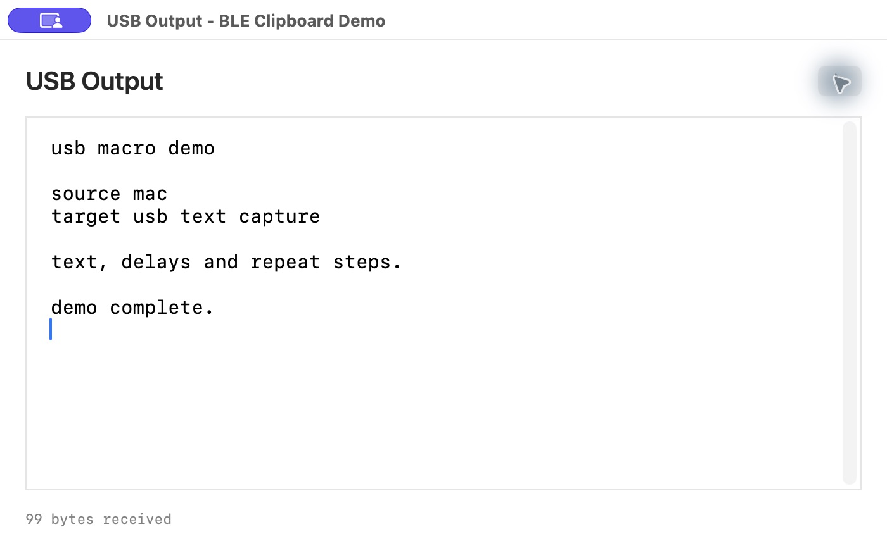
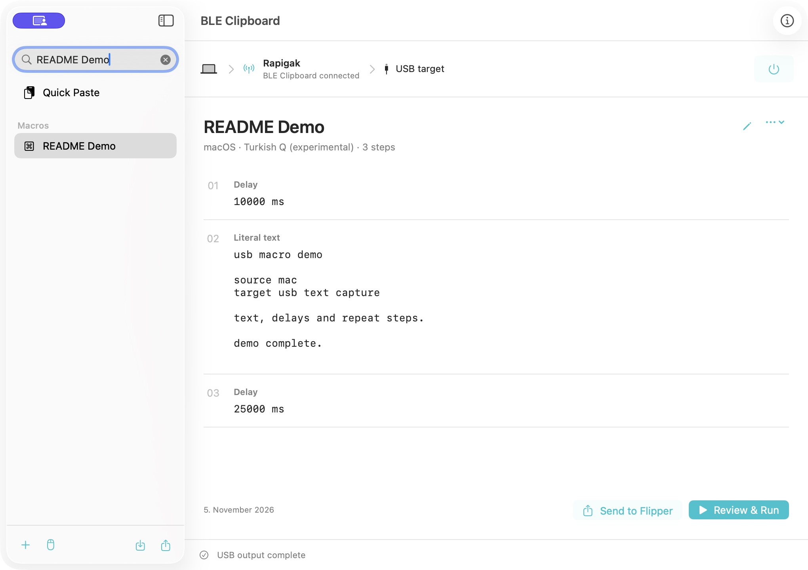
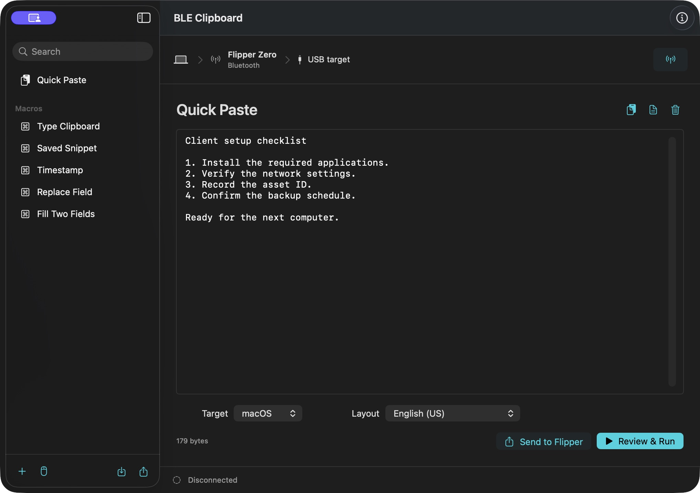
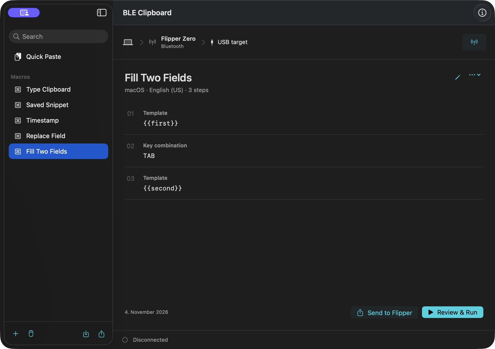
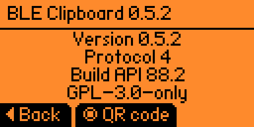
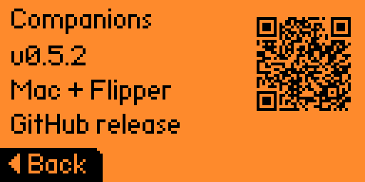

<p align="center">
  
</p>

<h1 align="center">BLE Clipboard</h1>

<p align="center">Your Mac's clipboard and macros, delivered through Flipper Zero.</p>

<p align="center">
  <a href="https://github.com/otcan/ble-clipboard/releases/download/v0.5.3/BLE-Clipboard-0.5.3-universal.zip">Download Mac App</a> &middot;
  <a href="https://github.com/otcan/ble-clipboard/releases/download/v0.5.3/ble_clipboard.fap">Download Flipper App</a> &middot;
  <a href="#install-the-matching-pair">Setup Guide</a> &middot;
  <a href="#screenshots">Screenshots</a>
</p>

Review text or create a macro on your Mac, then send it over Bluetooth LE to
Flipper Zero. Connected by USB, the Flipper acts as a keyboard and mouse on the
target device. No companion app is needed on the target.

```text
Mac app -- Bluetooth LE --> Flipper Zero -- USB keyboard/mouse --> Target
```

Free and open source under GPL-3.0-only. The current release is
[0.5.3](https://github.com/otcan/ble-clipboard/releases/tag/v0.5.3).

## Install the Matching Pair

Install **both apps from the same release**. The Mac app creates and sends jobs;
the Flipper app runs them over USB.

You need macOS 14 Sonoma or later (Apple Silicon or Intel), a Flipper Zero with
a microSD card, and a USB data cable. The packaged FAP targets official firmware
1.5.1 / API 88.2. No developer tools or custom firmware are needed.

### 1. Mac App

With [Homebrew](https://brew.sh):

```sh
brew tap otcan/ble-clipboard
brew install --cask otcan/ble-clipboard/ble-clipboard
```

Without Homebrew, [download the Mac app](https://github.com/otcan/ble-clipboard/releases/download/v0.5.3/BLE-Clipboard-0.5.3-universal.zip),
unzip it and move **BLE Clipboard.app** to Applications. Quit an older copy
before replacing it. The published Mac app is Developer ID signed,
Apple-notarized and ticket-stapled.

**Homebrew installs only the Mac app.** Install the Flipper companion separately.

### 2. Flipper App

First install **qFlipper**, the official desktop file manager for Flipper Zero:

```sh
brew install --cask qflipper
```

Or use the [official qFlipper download](https://flipper.net/pages/downloads).
Already have qFlipper? Skip that step.

1. [Download the Flipper app](https://github.com/otcan/ble-clipboard/releases/download/v0.5.3/ble_clipboard.fap).
   Keep the filename `ble_clipboard.fap`; no extraction is needed.
2. Stop any active job, exit to the Flipper's home screen and connect it to
   your Mac with the USB data cable. Leave the microSD card inserted.
3. Open qFlipper's **File Manager**, then **SD Card > apps > Bluetooth**.
   Create the folders if needed, then drag the FAP into that folder or choose
   **Upload here**. Preserve an older copy first if needed.
4. On the Flipper, open **Apps > Bluetooth > BLE Clipboard**.

The full device path is `/ext/apps/Bluetooth/ble_clipboard.fap`.
You can close qFlipper after copying the file; it is not needed during use.
See the [official file-upload guide](https://docs.flipper.net/zero/qflipper#how-to-upload-files-using-qflipper)
if this is your first Flipper app.

<details>
<summary>No qFlipper? Install with a microSD card reader</summary>

With the Flipper powered off, put its microSD card in a card reader and copy
`ble_clipboard.fap` into `apps/Bluetooth/` on the card. Create the folders if
needed. Eject the card, put it back in the Flipper and open
**Apps > Bluetooth > BLE Clipboard** after turning it on.

</details>

The [Flipper Apps Catalog submission](https://github.com/flipperdevices/flipper-application-catalog/pull/1379)
is awaiting maintainer review. Use the FAP download above until it is accepted.

Both downloads and [SHA256SUMS.txt](https://github.com/otcan/ble-clipboard/releases/download/v0.5.3/SHA256SUMS.txt)
are also available on the [0.5.3 release page](https://github.com/otcan/ble-clipboard/releases/tag/v0.5.3).

### Updating

Quit the Mac app before upgrading:

```sh
brew update
brew upgrade --cask otcan/ble-clipboard/ble-clipboard
```

Then exit the Flipper app and replace its FAP with the matching version.
Version 0.5.3 fixes SD initialization for saving snapshots and programs larger
than 4 KiB. No SD formatting, saved-job migration or pairing-key deletion is needed.
See the [changelog](CHANGELOG.md) for earlier releases and compatibility notes.

## Use

1. Open both apps. On the Mac, choose **Connect**, select your Flipper and allow
   Bluetooth access. Compare and approve the matching pairing codes on both devices.
2. Connect the Flipper by USB to a device you own or have permission to operate.
   The USB target can be the source Mac or another computer.
3. Choose **Quick Paste** or a macro, then match the target OS and keyboard layout.
4. Review the expanded text and actions. Focus a disposable plain text document
   on the target, confirm the target and choose **Run on USB**.

If the source Mac is also the target, hide the Mac app before output and check
the receiving document's focus. Focus restoration is not guaranteed.

**To stop:** use Stop on the Mac, or press **Left or Back** on the Flipper during
a job. Stop releases Flipper-held keys and mouse buttons but cannot undo input
already sent. Tabs and newlines are real keys: start with a text document, not
a terminal, password field or form that submits on Enter.

## Features

| Feature | What you can do |
| --- | --- |
| Quick Paste | Load clipboard text or import a text file, review it, then send it as USB keystrokes. |
| Macros | Combine text, templates, parameters, keyboard shortcuts, delays, mouse movement and timed repeats. Import and export your library as JSON. |
| Saved jobs | Keep up to 20 clipboard or macro snapshots on the Flipper's SD card and run them without the Mac. |
| Standalone runs | Continue selected jobs without the Mac, with a timer and physical Stop. Timed repeats support up to 24 hours. |
| Target layouts | Choose from 28 keyboard layouts for both Quick Paste and macros. See [text support and layout requirements](#layouts-and-text). |

## Screenshots

### Mac: Live Macro Run



A real 0.5.3 run through Flipper Zero, captured during the macro's final delay.

### USB Target: Received Output



The actual USB keystrokes received on the target Mac. All **99 bytes matched**
the macro. This scratch receiver is only for the demo; targets need no app.

<details>
<summary>Completed run and more Mac screens</summary>

**The same run, completed**



**Quick Paste (offline preview)**



**Saved macro workspace (offline preview)**



</details>

### Flipper: Info and Companion Downloads

<p>
  
  
</p>

[Screenshot details](docs/ARTWORK.md#documentation-screenshots).

## Standalone Jobs and Mouse Jiggle

**Send to Flipper** saves a reviewed clipboard or macro snapshot without running
it. Clipboard text, timestamps and parameter values are fixed at send time.
The SD library holds up to 20 entries. Sending the same macro again replaces its
snapshot; separate Quick Paste reviews create separate entries.

On the Flipper, **Up/Down** selects an entry, **OK** opens it and **Run** needs a
second confirmation with a three-second focus allowance. **Right** opens Delete
confirmation. Saved entries survive restart, but never run automatically.

For a live job, enable **Continue on Flipper if this Mac disconnects** in run
review to keep it running without the Mac. Normal jobs stop on Bluetooth loss.
Standalone jobs show elapsed/remaining time, can be stopped on the Flipper and
end permanently on USB loss, app exit or power loss. Reconnecting the Mac lets
you view and stop the active job; it does not restart it.

**Move Mouse** and **Repeat** support fixed values or ranges. The Mouse Jiggle
preset creates an eight-hour repeat with X/Y ranges of -2...2 HID units and
45...95-second intervals; you can edit those values before running it.
Movement releases Flipper-held mouse buttons first, but cannot override another
mouse's held button or an OS drag-lock setting. Movement may drift and is not
guaranteed invisible, undetectable or to prevent an application's idle policy.
See the [macro guide](docs/MACROS.md) for step limits, templates and repeat behavior.

## Layouts and Text

The layout must match the **USB target's input source**, not necessarily the Mac's.
Most layouts support printable ASCII, Tab and line breaks. Native Turkish
letters are experimental with Turkish Q; arbitrary Unicode, other native
alphabets and IME input are not supported.

US and macOS Turkish Q are built in. The Turkish map targets Apple's
**Turkish QWERTY PC**, not Turkish Q Legacy. Most other choices need the matching
official `.kl` file under `/ext/badusb/assets/layouts/`. Missing or unmapped
layout assets reject the job before it runs.

On macOS Turkish Q, some characters use Option. Global shortcuts triggered by
repeated modifier presses can interrupt typing; use a non-conflicting target
shortcut. See [target shortcut compatibility](docs/HARDWARE-VALIDATION.md#target-shortcut-compatibility).

### Standalone Keyboard Settings (0.5.4 Development)

This feature is in the unreleased 0.5.4 source, not the 0.5.3 downloads above.
On the idle Flipper library, press **Left > Keyboard**. Choose the target OS,
open Layout for any of the 28 choices, then select **Save keyboard**. The setting
is stored on SD and survives Mac disconnection and Flipper app restart.

**Saved runs: Device** applies that keyboard to local runs without rewriting
snapshots. **Saved runs: Original** preserves each snapshot's own keyboard; this
is the upgrade default. The effective OS/layout is shown before Run. Missing
layout assets or unsupported text reject the run instead of falling back to US.
Saved shortcuts remain compiled for their original OS; resend a macro from the
Mac when its shortcut semantics need to change.

The Mac toolbar's **Flipper Keyboard** panel and Quick Paste controls share this
setting. Changes sync while connected and idle. On reconnect, the Flipper's
setting wins, including edits made without the Mac. New macros use these
defaults; existing Mac macro definitions keep their explicit OS/layout. Settings
cannot change during a job, and syncing never starts USB output.

<details>
<summary>All 28 target layout choices</summary>

US/UK, Turkish Q, Bosnian, Czech, Danish, German/Swiss German, Dvorak,
Spanish/Latin American, French/Belgian/Canadian/Swiss/Mac French, Croatian,
Hungarian, Italian/Mac Italian, Japanese, Norwegian, Dutch, Portuguese/Brazilian,
Slovenian, Slovak and Swedish.

</details>

## Privacy

Clipboard access is explicit. There is no cloud account, analytics service,
clipboard watcher, global keyboard hook or target-side agent. Bluetooth pairing
protects transfers, but does not encrypt files saved on either device.

Mac definitions, backups, JSON exports and saved SD snapshots are **plaintext**.
Jobs larger than 4 KiB also use a temporary SD file, cleaned up on completion,
Stop, exit or the next startup. Deleting a file is not secure erasure.
Logs omit text and parameter contents. See [SECURITY.md](SECURITY.md) for security
reporting and [protocol details](docs/PROTOCOL.md) for the transport model.

## Info and Companion Downloads

**Info & Companions** on the Mac shows both app versions and links to their
matching release. On the idle Flipper screen, press **Right** for Info, then
**OK** for its download QR code.

Opening or refreshing the Mac Info panel checks that version's public GitHub
release. Downloads are enabled only when the matching app assets and checksum
file are available. There is no automatic download, installation or fallback
to an older version. Older companions may report their app version as Unknown.

## Status and Feedback

This is an **early 0.x release**. Automated Swift and C checks cover macro
compilation, protocol handling, layouts, storage and cancellation. A real 0.5.3
text-and-delay run passed with byte-for-byte USB output verification. Physical
SD save/restart/run, wider focus/layout and multi-hour target checks remain open;
see the [validation record](docs/HARDWARE-VALIDATION.md).

Found a bug? [Open an issue](https://github.com/otcan/ble-clipboard/issues) with
your Mac version, Flipper firmware, target OS/layout and non-sensitive steps
to reproduce. Do not include real clipboard data, secrets or pairing keys.

## Build

For development, install Xcode/Swift and uFBT with the matching official SDK:

```sh
swift test --package-path BLEClipboardMac
sh scripts/check_clipboard.sh
UFBT=ufbt sh scripts/build_flipper.sh
BLEClipboardMac/build_app.sh --universal
```

Source builds are ad-hoc signed by default; they are not the notarized release
download. Building does not install either app or start keyboard/mouse output.
See [development and release](docs/DEVELOPMENT.md) for prerequisites, packaging
and signing, and [CONTRIBUTING.md](CONTRIBUTING.md) before submitting changes.

## Documentation

[Macro guide](docs/MACROS.md) &middot; [Protocol](docs/PROTOCOL.md) &middot;
[Validation](docs/HARDWARE-VALIDATION.md) &middot;
[Development](docs/DEVELOPMENT.md) &middot;
[Store preparation](Store/README.md) &middot; [Changelog](CHANGELOG.md)

## License

[GPL-3.0-only](LICENSE). Not affiliated with Flipper Devices, Apple or Homebrew.
See [NOTICE](NOTICE) for notices and [artwork provenance](docs/ARTWORK.md).
