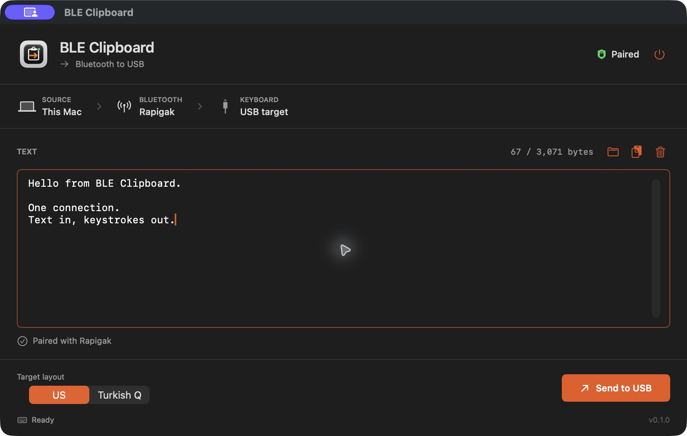

<p align="center">
  
</p>

<h1 align="center">BLE Clipboard</h1>

<p align="center">A wireless clipboard bridge for your Flipper Zero USB keyboard.</p>

<p align="center">
  <a href="https://github.com/otcan/ble-clipboard/releases">Downloads</a> ·
  <a href="docs/PROTOCOL.md">Protocol</a> ·
  <a href="docs/DEVELOPMENT.md">Build from source</a> ·
  <a href="LICENSE">GPL-3.0</a>
</p>



```text
Your Mac  -- authenticated Bluetooth LE -->  Flipper Zero  -- USB keyboard -->  Target
```

Paste text into the Mac app, then send it through the Flipper's USB port. No SD
card file copying, DuckyScript editing, or Bluetooth profile switching between
transfers. The target needs no companion software, only USB keyboard support.

## Install

### macOS

macOS 14 Sonoma or later. Apple Silicon and Intel are included in one app.

```sh
brew tap otcan/ble-clipboard
brew install --cask otcan/ble-clipboard/ble-clipboard
```

Or download the universal `.zip` from [Releases](https://github.com/otcan/ble-clipboard/releases),
extract it, and move **BLE Clipboard.app** to Applications.

**Early release:** the app is ad-hoc signed, not Apple-notarized. macOS may block
its first launch. Review the source/download, then use the normal macOS
**System Settings > Privacy & Security > Open Anyway** approval if you trust it.
Do not disable Gatekeeper. Building locally is another option.

### Flipper Zero

1. Download `ble_clipboard.fap` from the same release.
2. Exit any running Flipper app before transferring files over USB.
3. Using qFlipper, put the file at `/ext/apps/Bluetooth/ble_clipboard.fap`.
4. Open **Apps > Bluetooth > BLE Clipboard** on the Flipper.

The published `.fap` targets official firmware **1.5.1, API 88.2**. A different
firmware/API may require rebuilding against its matching SDK. Installing the
Homebrew cask installs only the Mac app, not the Flipper application.

## Use

1. Open BLE Clipboard on both devices.
2. Allow Bluetooth access on the Mac if requested.
3. Compare and approve the pairing code on both devices. The BLE name is **Paste**.
4. Connect the Flipper's USB cable to your target device and focus a plain text field.
5. Enter text, use **Load Clipboard**, or open a small text file in the Mac app.
6. Select the keyboard layout active on the **target**, then **Send to USB**.

The app remembers the Bluetooth peripheral and reconnects without pairing again
while the bond remains valid. It hides after acceptance by default, restoring
focus when this same Mac is also the USB target. This can be changed in Settings.

**Back on the Flipper exits and restores normal USB/Bluetooth.** While the app is
running, the USB serial port disappears because the Flipper is a keyboard. A
connected cable is not enough for firmware uploads: exit the app first.

## What's Included

- Native SwiftUI Mac utility with dark/light appearance, a focused text editor,
  live validation, file import, transfer status, cancellation, and an app icon.
- Flipper application with a compact 128x64 status layout.
- Authenticated, bonded BLE transport and a versioned handshake.
- Persistent BLE control connection with separate USB HID output.
- US and Turkish Q target layouts.
- No cloud account, network service, clipboard watching, or target-side agent.
- Universal Mac builds, unit tests, CI, release packaging, and a Homebrew tap.

## Limits and Safety

- **1-3,071 ASCII bytes** per send. Tabs and newlines are supported; arbitrary
  Unicode, emoji, and non-ASCII letters are rejected, not silently replaced.
- Turkish Q needs the Flipper firmware asset
  `/ext/badusb/assets/layouts/tr-TR.kl`. Match the target's active layout.
- This **types keystrokes**. It does not modify the target's OS clipboard or send
  Command-V. Enter and Tab retain their normal behavior, so avoid a terminal or
  submit-on-Enter form for your first test.
- Requests are not automatically replayed. Check the target after a partial
  transfer before resending; typing cannot be rolled back by Cancel.
- "Sent" confirms USB HID report submission, not that a particular target app
  received or stored the intended text.
- Only use it with target devices you own or have permission to operate.

## Privacy

Draft text is held in memory and is not intentionally saved by either app.
It is sent only after an explicit action. The Mac stores the selected layout,
hide-after-send preference, and CoreBluetooth peripheral identifier. The Flipper
stores its pairing keys on its SD card. Connection logs omit clipboard contents.

Bluetooth numeric-comparison pairing authenticates the devices and protects the
transport. The application handshake checks protocol compatibility; it is not a
separate app password. Other software running on a trusted paired computer may
have access to its Bluetooth connection. See [Security](SECURITY.md).

## Development

```sh
git clone https://github.com/otcan/ble-clipboard.git
cd ble-clipboard
cd BLEClipboardMac
swift test
./build_app.sh --universal
```

The Mac bundle is created at `BLEClipboardMac/dist/BLE Clipboard.app`.
See [Development](docs/DEVELOPMENT.md) for the pinned Flipper SDK, release
packaging, code signing, tests, and the source layout.

## Verification

A short ASCII transfer has been verified on real hardware from Mac BLE to
Flipper USB output. The native Mac tests cover framing, fragmented/repeated
responses, validation, and file loading. Long transfers, cancellation mid-typing,
and Turkish Q still need broader hardware testing. This is an early **0.1.0** release.

## License and Credits

[GPL-3.0-only](LICENSE). This independent project uses the public
[Flipper Zero SDK](https://github.com/flipperdevices/flipperzero-firmware).
Not affiliated with Flipper Devices, Apple, or Homebrew. See [NOTICE](NOTICE).
